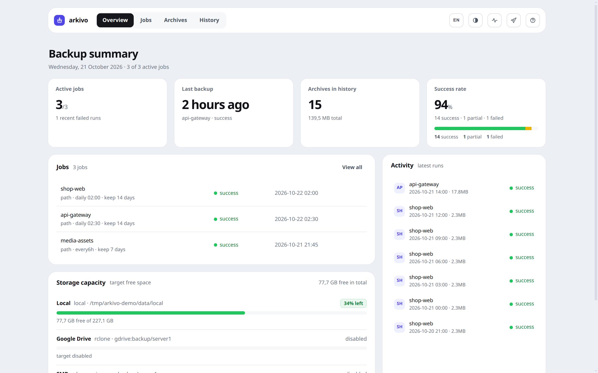
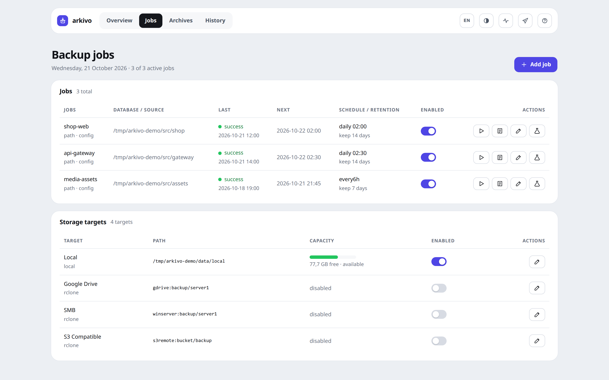

<p align="center">
  
</p>

<h1 align="center">Arkivo</h1>

<p align="center">
  <em>One archive per job. Many destinations. No surprises.</em><br>
  <sub><a href="#english">English</a> · <a href="#bahasa-indonesia">Bahasa Indonesia</a></sub>
</p>

---

<p align="center">
  
  <br>
  <sub>Overview: run status, success rate, and target capacity at a glance.</sub>
</p>

<p align="center">
  
  <br>
  <sub>Jobs and storage targets: source, schedule, retention, and capacity.</sub>
</p>

---

<a id="english"></a>

## English

Arkivo backs up databases (PostgreSQL, MySQL/MariaDB) and project folders into
**a single archive per job**, then ships it to many storage targets. Built with
the Python standard library and a systemd timer — no extra dependencies.

**Why one archive?** The usual failure mode of manual backups is uploading
thousands of small files to SMB or Google Drive: slow, flaky, half-finished.
One archive per job uploads as one stream and either succeeds or fails cleanly.

### Features

- **Sources** — PostgreSQL, MySQL/MariaDB, plain folders, or a remote server over SSH
- **Many databases per job**, each producing its own restorable archive
- **Targets** — Local, Google Drive, SMB, S3-compatible, SSH/SFTP (via rclone), NFS (mounted locally)
- **Scheduling** — `manual`, `every30m`, `every6h`, `daily 02:00`, `weekly 6 23:00`
- **Retention** — old archives pruned automatically per target
- **Dashboard** — live progress, run history, archive browsing and download, built-in
  archive verification, diagnostics, English/Indonesian switch
- **Telegram notifications** when a run finishes
- **Secrets stay out of the browser** — database passwords never travel back to the UI

### Install

```bash
git clone git@github.com:ramadhanifajar/arkivo.git /var/www/arkivo
cd /var/www/arkivo
sudo ./install.sh            # detects distro, installs only what your config uses
sudo ./install.sh --dry-run  # show the plan, change nothing
```

The installer copies `config.example.toml` to `config.toml`, generates a random
`dashboard_token`, and installs `arkivo.timer` (every 5 minutes) plus
`arkivo-dashboard.service`.

### Configure

Edit `config.toml`. Minimal example:

```toml
[general]
data_dir = "/var/www/arkivo/data"
dashboard_port = 8787
dashboard_token = ""          # empty = generated per start; set it to keep the URL stable

[[targets]]
name = "Local"
type = "local"
path = "/var/www/arkivo/data/local"

[[job]]
name = "pg-main"
type = "postgres"
host = "127.0.0.1"
port = 5432
user = "postgres"
databases = ["*"]
schedule = "daily 02:00"
retention_days = 14
```

See [`TUTORIAL.md`](TUTORIAL.md) for every option: multiple databases, SSH
sources, rclone targets, Telegram, and troubleshooting.

### Commands

```bash
python3 arkivo.py doctor            # check prerequisites and health
python3 arkivo.py list              # jobs, schedules, due status
python3 arkivo.py run <job>         # run one job now
python3 arkivo.py tick              # run every due job (systemd timer calls this)
python3 arkivo.py serve             # dashboard
python3 test_arkivo.py              # self-check
```

Dashboard: `http://127.0.0.1:8787/?token=<dashboard_token>`. It binds to
localhost by default — reach it through an SSH tunnel, not by exposing the port.

### Restore

```bash
./restore.sh pg  <file.dump>    <db>     # PostgreSQL
./restore.sh my  <file.sql.zst> [db]     # MySQL / MariaDB
./restore.sh tar <file.tar.zst> <dir>    # project folder
```

Every archive also carries a `CARA-BUKA.txt` note explaining how to open it.

---

<a id="bahasa-indonesia"></a>

## Bahasa Indonesia

Arkivo mem-backup database (PostgreSQL, MySQL/MariaDB) dan folder project menjadi
**satu berkas arsip per job**, lalu mengirimkannya ke banyak target penyimpanan.
Dibangun dengan pustaka standar Python dan systemd timer — tanpa dependency tambahan.

**Kenapa satu arsip?** Kegagalan paling umum pada backup manual adalah mengunggah
ribuan file kecil ke SMB atau Google Drive: lambat, rawan putus, dan sering
setengah jadi. Satu arsip per job diunggah sebagai satu aliran data, jadi hasilnya
jelas berhasil atau gagal.

### Fitur

- **Sumber** — PostgreSQL, MySQL/MariaDB, folder biasa, atau server lain lewat SSH
- **Banyak database dalam satu job**, masing-masing menghasilkan arsip yang bisa
  dipulihkan terpisah
- **Target** — Local, Google Drive, SMB, S3-compatible, SSH/SFTP (lewat rclone),
  NFS (di-mount di level OS)
- **Jadwal** — `manual`, `every30m`, `every6h`, `daily 02:00`, `weekly 6 23:00`
- **Retensi** — arsip lama dihapus otomatis per target
- **Dashboard** — progres langsung, riwayat run, penjelajahan dan unduh arsip,
  verifikasi arsip bawaan, diagnostik, pilihan bahasa Inggris/Indonesia
- **Notifikasi Telegram** setelah run selesai
- **Kredensial tidak pernah ke browser** — password database tidak dikirim balik ke UI

### Pasang

```bash
git clone git@github.com:ramadhanifajar/arkivo.git /var/www/arkivo
cd /var/www/arkivo
sudo ./install.sh            # deteksi distro, pasang hanya yang dipakai config
sudo ./install.sh --dry-run  # lihat rencananya tanpa mengubah apa pun
```

Installer menyalin `config.example.toml` menjadi `config.toml`, membuat
`dashboard_token` acak, lalu memasang `arkivo.timer` (tiap 5 menit) dan
`arkivo-dashboard.service`.

### Konfigurasi

Sunting `config.toml`. Contoh minimal:

```toml
[general]
data_dir = "/var/www/arkivo/data"
dashboard_port = 8787
dashboard_token = ""          # kosong = dibuat acak tiap start; isi agar URL tetap

[[targets]]
name = "Local"
type = "local"
path = "/var/www/arkivo/data/local"

[[job]]
name = "pg-main"
type = "postgres"
host = "127.0.0.1"
port = 5432
user = "postgres"
databases = ["*"]
schedule = "daily 02:00"
retention_days = 14
```

Seluruh opsi dijelaskan di [`TUTORIAL.md`](TUTORIAL.md): banyak database, sumber
SSH, target rclone, Telegram, dan penyelesaian masalah.

### Perintah

```bash
python3 arkivo.py doctor            # periksa prasyarat & kesehatan
python3 arkivo.py list              # daftar job, jadwal, status jatuh tempo
python3 arkivo.py run <job>         # jalankan satu job sekarang
python3 arkivo.py tick              # jalankan job yang jatuh tempo (dipanggil timer)
python3 arkivo.py serve             # dashboard
python3 test_arkivo.py              # uji mandiri
```

Dashboard: `http://127.0.0.1:8787/?token=<dashboard_token>`. Secara bawaan hanya
mendengarkan di localhost — akses lewat terowongan SSH, jangan buka portnya ke publik.

### Restore

```bash
./restore.sh pg  <file.dump>    <db>     # PostgreSQL
./restore.sh my  <file.sql.zst> [db]     # MySQL / MariaDB
./restore.sh tar <file.tar.zst> <dir>    # folder project
```

Setiap arsip juga memuat berkas `CARA-BUKA.txt` berisi petunjuk membukanya.

---

## Lisensi

Apache License 2.0 — lihat [`LICENSE`](LICENSE).
